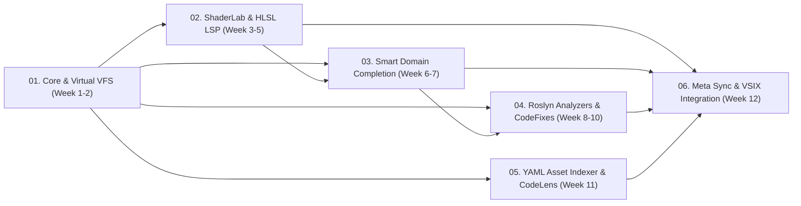

# UnityBrain Master Architecture & AI Execution Plan

> **문서 목적**: 본 문서는 VS Code에서 JetBrains Rider 수준의 Unity 개발 경험을 제공하기 위한 확장 프로그램 **UnityBrain**의 최상위 마스터 기획서다. 여러 AI 에이전트(ChatGPT, Claude, Gemini 등)가 개별 세부 계획서(`docs/plans/01~06`)를 독립적으로 구현하더라도 **동일한 아키텍처, 동일한 디렉터리 구조, 동일한 데이터 계약(Schema)** 아래 완벽히 결합되도록 설계 기준을 정의한다.

---

## 1. 프로젝트 목표 및 전제 경계 (Prerequisite Boundary)

### 1.1 최종 목표
* 사용자가 VS Code에서 **UnityBrain** 확장 프로그램 하나만 추가 설치하면 JetBrains Rider의 핵심 Unity 기능(Shader/HLSL 패키지·폴더 간 정의 이동, 고성능 도메인 자동완성, Call-Graph 기반 성능 코드 조언 및 자동 캐싱 리팩토링, Burst 정적 검사, Scene/Prefab 사용처 추적 CodeLens, `.meta` 동기화)을 동일 수준의 정확도와 응답 속도로 제공한다.

### 1.2 전제 조건 (`extensionDependencies`)
UnityBrain은 바퀴를 재발명하지 않는다. VS Code 마켓플레이스의 공식 Microsoft 확장이 이미 설치되어 있음을 전제로 `packages/extension/package.json`에 아래 의존성을 선언한다.
* `ms-dotnettools.csharp` (또는 `ms-dotnettools.csdevkit` — 기본 C# Roslyn LSP, IntelliSense, 디버깅, 솔루션/프로젝트 로더 제공)
* `visualstudiotoolsforunity.vstuc` (Microsoft 공식 Unity 확장 — Unity Debugger Attach, 기본 `UNT0001`~`UNT0038` 진단, 기본 `.shader`/`.asmdef` TextMate 문법, Unity 메시지 기본 문서화 제공)

### 1.3 기능 경계표 (역할 분담 및 중복 구현 금지 원칙)

| 기능 영역 | 기존 확장 (`csharp` + `vstuc`) 담당 | **UnityBrain** 신규 구현 범위 |
| :--- | :--- | :--- |
| **C# 기본 LSP & 디버깅** | C# 구문 강조, 기본 자동완성, Unity Editor 디버거 연결, 중단점 | 구현 금지 (기존 LSP 위에서 동작) |
| **기본 Unity 진단 (`UNT`)** | `Microsoft.Unity.Analyzers` (`UNT0001`~`UNT0038`, `USPxxxx`: 빈 메시지, `CompareTag`, 비제네릭 `GetComponent`, `Transform.SetPositionAndRotation` 등) | **동일 규칙 재구현 금지**. 대신 `vstuc`에 없는 **콜그래프 기반 간접 성능 경고, 자동 캐싱 Quick-Fix, Burst 정적 검증, 문자열 리터럴 정합성 검증(`UB1xxx`~`UB4xxx`)**만 구현 |
| **ShaderLab & HLSL** | 단순 TextMate 컬러링만 제공 (정의 이동/패키지 해석/심볼 분석 없음) | **핵심 차별화 영역**: `Packages/...` 및 `CGIncludes` 가상 경로 해석, `.shader` 내 `HLSLPROGRAM`/`HLSLINCLUDE` 가상 문서 추출, 다단계 `#include` 그래프, 함수·구조체·매크로 `F12` 정의 이동, Hover, 자동완성, Keyword Variant 전환 |
| **도메인 자동완성** | 기본 C# API 및 일부 Unity 메시지 이름 | **고도화 영역**: `api.xml` 기반 코루틴/파라미터 완전 생성 스니펫 + `ProjectSettings`(Tag, Layer, SortingLayer, Input Axis, Build Scene), Shader Property(`_BaseMap` 등), Animator Parameter, `Invoke`/`StartCoroutine` 문자열 컨텍스트 자동완성 |
| **에셋(YAML) & `.meta`** | 미지원 | `.NET 8` 백그라운드 데몬(`unity-daemon`)을 통한 `.unity`/`.prefab`/`.asset` 스트리밍 인덱싱, `N Asset Usages` CodeLens, Inspector 직렬화 값 표시, 파일 생성·이동·삭제 시 `.meta` 자동 동기화 |

---

## 2. 통합 모노레포 디렉터리 구조

모든 AI 에이전트는 아래 경로를 **절대 기준**으로 생성 및 수정한다. 임의로 디렉터리명을 변경하거나 최상위 구조를 재편하지 않는다.

```text
d:\Noogs\NextCloud\Projects\UnityBrain\
├── PLAN.md                                 # [본 문서] 마스터 아키텍처, 스키마, AI 규칙
├── AGENTS.md                               # [자율 실행 규칙] 전 AI 코딩 에이전트 공통 무중단 실행 정책
├── CLAUDE.md                               # Claude Code 자동 로드 지침 (@AGENTS.md, @PLAN.md 연계)
├── PROGRESS.json                           # [체크포인트 상태] Limit 중단 시 파일 단위 이어하기용 실시간 진행률
├── package.json                            # 루트 pnpm 워크스페이스 및 통합 스크립트
├── pnpm-workspace.yaml                     # packages/*, tools/* 선언
├── UnityBrain.sln                          # .NET 솔루션 (Analyzers + Daemon + Tests)
├── schemas/                                # [Single Source of Truth] 공유 JSON/TS 계약
│   ├── unity-context.schema.json
│   ├── unity-api.schema.json
│   ├── project-settings.schema.json
│   ├── shader-index.schema.json
│   └── daemon-rpc.schema.json
├── tools/
│   └── api-extractor/                      # resharper-unity api.xml -> unity-api.json 변환기
│       ├── package.json
│       ├── tsconfig.json
│       └── src/index.ts
├── packages/
│   ├── extension/                          # VS Code Extension Host (Node.js / TypeScript)
│   │   ├── package.json
│   │   ├── tsconfig.json
│   │   └── src/
│   │       ├── extension.ts
│   │       ├── contracts/                  # schemas/ 기반 TS 타입 정의
│   │       ├── core/
│   │       │   ├── unityProjectContext.ts
│   │       │   └── virtualPathResolver.ts
│   │       ├── watchers/
│   │       │   └── projectSettingsWatcher.ts
│   │       ├── completion/
│   │       │   ├── unityStringCompletionProvider.ts
│   │       │   └── unityEventGenerator.ts
│   │       ├── analyzers/
│   │       │   └── msbuildInjector.ts
│   │       ├── codelens/
│   │       │   └── unityAssetUsageCodeLensProvider.ts
│   │       ├── meta/
│   │       │   └── metaFileSyncManager.ts
│   │       └── shader/
│   │           └── shaderKeywordContextStatusBar.ts
│   ├── shader-lsp/                         # ShaderLab / HLSL 전용 Language Server (TS + Tree-sitter)
│   │   ├── package.json
│   │   ├── tsconfig.json
│   │   └── src/
│   │       ├── server.ts
│   │       ├── vfs/
│   │       │   └── virtualPathResolver.ts
│   │       ├── parser/
│   │       │   ├── shaderLabVirtualDoc.ts
│   │       │   └── unityHlslMacroPrepass.ts
│   │       ├── indexer/
│   │       │   ├── hlslIncludeGraph.ts
│   │       │   └── hlslSymbolTable.ts
│   │       └── providers/
│   │           ├── definitionProvider.ts
│   │           ├── completionProvider.ts
│   │           └── hoverProvider.ts
│   └── unity-daemon/                       # .NET 8 백그라운드 YAML/GUID 인덱서 데몬 (JSON-RPC)
│       ├── UnityBrain.Daemon.csproj
│       ├── Program.cs
│       ├── RpcServer.cs
│       ├── Indexing/
│       │   ├── MetaGuidMap.cs
│       │   └── UnityYamlStreamParser.cs
│       └── Cache/
│           └── BinaryIndexCache.cs
├── analyzers/
│   ├── UnityBrain.Analyzers/               # Roslyn Analyzer & CodeFix (.NET Standard 2.0)
│   │   ├── UnityBrain.Analyzers.csproj
│   │   ├── Diagnostics/
│   │   ├── CallGraph/
│   │   └── CodeFixes/
│   └── UnityBrain.Analyzers.Tests/         # xUnit + Roslyn Testing 단위 테스트
│       └── UnityBrain.Analyzers.Tests.csproj
├── test-fixtures/                          # 테스트용 모의 Unity 프로젝트 (URP, Shader, Prefab)
│   └── SampleUnityProject/
└── docs/
    └── plans/                              # 모듈별 AI 실행용 세부 기획서
        ├── 01-core-and-virtual-vfs.md
        ├── 02-shaderlab-hlsl-lsp.md
        ├── 03-smart-domain-completion.md
        ├── 04-roslyn-analyzers-and-codefixes.md
        ├── 05-yaml-asset-indexer-and-codelens.md
        └── 06-meta-sync-and-integration.md
```

---

## 3. 공유 데이터 계약 (Single Source of Truth)

모든 모듈은 아래 TypeScript / JSON 계약을 엄격히 준수한다. TypeScript 모듈은 `packages/extension/src/contracts/` (또는 `schemas/`)의 인터페이스를 공유하며, C# 모듈(`UnityBrain.Analyzers`, `UnityBrain.Daemon`)은 동일한 필드명(camelCase JSON 직렬화)을 사용한다.

### 3.1 `UnityProjectContext` & `VirtualPathMapping`
```typescript
export interface UnityProjectContext {
  projectRoot: string;            // Unity 프로젝트 루트 절대 경로 (Assets, ProjectSettings 포함)
  editorVersion: string;          // 예: "2022.3.45f1" 또는 "6000.0.23f1"
  editorInstallPath: string | null; // 예: "C:/Program Files/Unity/Hub/Editor/6000.0.23f1/Editor"
  cgIncludesPath: string | null;    // "{editorInstallPath}/Data/CGIncludes"
  builtInPackagesPath: string | null; // "{editorInstallPath}/Data/Resources/PackageManager/BuiltInPackages"
  manifestPath: string;           // "{projectRoot}/Packages/manifest.json"
  packagesLockPath: string | null; // "{projectRoot}/Packages/packages-lock.json"
  cacheDir: string;               // "{projectRoot}/Library/UnityBrainCache"
}

export type PackageResolutionSource =
  | 'embedded'
  | 'local'
  | 'registry'
  | 'git'
  | 'builtin'
  | 'packageCacheFallback'
  | 'cgIncludes';

export interface ResolvedPackageEntry {
  packageName: string;            // 예: "com.unity.render-pipelines.universal"
  version: string;                // 예: "14.0.11"
  source: PackageResolutionSource;
  physicalRoot: string;           // 디스크상 절대 경로
}

export interface VirtualPathMapping {
  virtualPath: string;            // 예: "Packages/com.unity.render-pipelines.universal/ShaderLibrary/Core.hlsl"
  physicalPath: string | null;    // 해석된 실제 파일 절대 경로
  resolvedVia: PackageResolutionSource | 'relative' | 'projectAssets' | 'unresolved';
  packageName?: string;
}
```

### 3.2 `UnityApiDatabase` (`unity-api.json`)
`tools/api-extractor`가 `JetBrains/resharper-unity`의 `api.xml`을 파싱하여 생성하며, **Extension(Event Generator)**과 **Roslyn Analyzer(`UB1xxx`, `AdditionalFiles`)**가 공통으로 읽는다.
```typescript
export interface UnityApiParameter {
  name: string;
  type: string;                   // C# 정규화 타입명 예: "UnityEngine.Collider"
  isOptional?: boolean;
  description?: string;
}

export interface UnityEventFunction {
  name: string;                   // 예: "OnTriggerEnter"
  returnType: string;             // 예: "void" 또는 "System.Collections.IEnumerator"
  supportsCoroutine: boolean;     // true면 IEnumerator 변형 허용
  isStatic?: boolean;
  isPerformanceCritical?: boolean; // Update, FixedUpdate, LateUpdate, OnGUI 등
  minimumUnityVersion?: string;
  maximumUnityVersion?: string;
  description: string;
  parameters: UnityApiParameter[];
}

export interface UnityApiTypeEntry {
  fullName: string;               // 예: "UnityEngine.MonoBehaviour"
  kind: 'class' | 'struct';
  minimumUnityVersion?: string;
  events: UnityEventFunction[];
}

export interface UnityApiDatabase {
  schemaVersion: 1;
  generatedAt: string;
  sourceCommit?: string;
  types: UnityApiTypeEntry[];
}
```

### 3.3 `ProjectSettingsCache` (`Library/UnityBrainCache/project-settings.json`)
`projectSettingsWatcher.ts`가 생성 및 갱신하며, Extension의 문자열 자동완성과 Roslyn Analyzer(`UB3002`, `UB3003`)의 `AdditionalFiles`로 동시 활용된다.
```typescript
export interface InputAxisEntry {
  name: string;
  descriptiveName?: string;
  type: number;
}

export interface BuildSceneEntry {
  name: string;                   // 확장자 제외 씬 이름 예: "MainMenu"
  path: string;                   // 예: "Assets/Scenes/MainMenu.unity"
  guid: string;
  buildIndex: number;
  enabled: boolean;
}

export interface AnimatorControllerIndex {
  assetPath: string;
  guid: string;
  parameters: Array<{ name: string; type: 'Float' | 'Int' | 'Bool' | 'Trigger' }>;
  states: string[];
}

export interface ProjectSettingsCache {
  schemaVersion: 1;
  updatedAt: string;
  tags: string[];                 // 기본 내장 태그("Untagged", "Player" 등) + TagManager 사용자 태그
  layers: Array<{ index: number; name: string }>;
  sortingLayers: Array<{ id: number; name: string }>;
  inputAxes: InputAxisEntry[];
  buildScenes: BuildSceneEntry[];
  animatorControllers: AnimatorControllerIndex[];
}
```

### 3.4 `ShaderSymbolIndex` (`shader-lsp` ↔ `extension` 공유 인덱스)
```typescript
export interface ShaderPropertyEntry {
  name: string;                   // 예: "_BaseMap"
  displayName: string;            // 예: "Albedo"
  propertyType: 'Float' | 'Range' | 'Color' | 'Vector' | '2D' | '3D' | 'Cube' | '2DArray' | 'Integer';
  defaultValue: string;
  shaderName: string;             // 예: "Universal Render Pipeline/Lit"
  filePath: string;
  line: number;                   // 0-based
}

export type HlslSymbolKind = 'function' | 'struct' | 'field' | 'macro' | 'cbuffer' | 'variable' | 'property';

export interface HlslSymbolEntry {
  name: string;
  kind: HlslSymbolKind;
  signature: string;              // 예: "half4 UniversalFragmentPBR(InputData inputData, SurfaceData surfaceData)"
  detail?: string;                // 소속 struct 또는 cbuffer 이름
  filePath: string;
  virtualPath?: string;           // 예: "Packages/com.unity.render-pipelines.universal/ShaderLibrary/Lighting.hlsl"
  range: {
    startLine: number;
    startCharacter: number;
    endLine: number;
    endCharacter: number;
  };
  documentation?: string;
}

export interface ShaderSymbolIndex {
  schemaVersion: 1;
  shaderNames: string[];
  properties: ShaderPropertyEntry[];
  symbolsByFile: Record<string, HlslSymbolEntry[]>;
}
```

### 3.5 `DaemonRpcProtocol` (`extension` ↔ `unity-daemon` JSON-RPC 2.0 over stdio)
```typescript
export interface AssetUsageLocation {
  assetPath: string;              // 프로젝트 상대 경로 예: "Assets/Scenes/Stage01.unity"
  assetType: 'scene' | 'prefab' | 'scriptableObject' | 'material' | 'other';
  gameObjectPath: string;         // 예: "Canvas/HUD/PlayerHealthBar"
  fileId: string;                 // YAML anchor fileID
  componentType?: string;
  usageKind: 'scriptComponent' | 'serializedField' | 'unityEventCallback';
  fieldName?: string;             // 예: "moveSpeed" 또는 "onClick"
  serializedValuePreview?: string; // 예: "5.5" 또는 "GameManager.OnPlayerDead"
}

export interface DaemonRpcMethods {
  'index/status': {
    params: Record<string, never>;
    result: { ready: boolean; assetCount: number; scriptCount: number; lastIndexedMs: number };
  };
  'index/rebuild': {
    params: { forceFull: boolean };
    result: { assetCount: number; durationMs: number };
  };
  'usage/findByScriptGuid': {
    params: { guid: string };
    result: { usages: AssetUsageLocation[] };
  };
  'usage/findByMethod': {
    params: { scriptGuid: string; methodName: string };
    result: { usages: AssetUsageLocation[] };
  };
  'inspector/getSerializedValues': {
    params: { scriptGuid: string; fieldName: string };
    result: { values: Array<{ assetPath: string; gameObjectPath: string; value: string }> };
  };
}
```

---

## 4. AI 실행 헌장 (ChatGPT / Claude / Gemini 공통 작업 규칙)

각 AI 모델에게 특정 Sub-Plan(`docs/plans/01~06`)의 구현을 위임할 때 아래 6가지 규칙을 반드시 프롬프트에 포함하고 준수하게 한다. 실제 단계별 실행 환경 세팅, 프롬프트 템플릿, 검증 명령어는 [AI_EXECUTION_PLAYBOOK.md](docs/AI_EXECUTION_PLAYBOOK.md)를 따른다.

1. **계약 우선 (Contract-First)**:
   * 모든 모듈 간 통신은 본 문서 섹션 3의 스키마/타입을 따른다. 다른 모듈이 의존하는 인터페이스 필드명이나 파일 경로를 임의로 변경하지 않는다.
2. **비침습적 MSBuild 주입 (Zero `.csproj` Mutation)**:
   * Unity는 에디터가 스크립트를 감지할 때마다 `.csproj`를 덮어쓴다. Roslyn Analyzer 및 `AdditionalFiles` 주입은 절대로 `.csproj`를 직접 수정하지 않고, 프로젝트 루트 `Directory.Build.props`의 `<!-- UnityBrain:Begin --> ... <!-- UnityBrain:End -->` 블록만 idempotent하게 관리한다.
3. **기존 Microsoft 확장과 중복 금지**:
   * `Microsoft.Unity.Analyzers`의 `UNT0001`~`UNT0038` 및 `USPxxxx` 규칙을 재구현하지 않는다. 진단 ID는 반드시 `UB1xxx`~`UB4xxx` 대역을 사용한다.
4. **오픈소스 참조 및 REA(`morluto/rea`) 사용 경계**:
   * 로직 참조는 Apache 2.0 라이선스인 [`JetBrains/resharper-unity`](https://github.com/JetBrains/resharper-unity)를 최우선 근거로 사용한다.
   * 비공개 바이너리(예: `JetBrains.ReSharper.Psi.Cpp.dll`의 HLSL 내장 매크로 목록 또는 `vstuc`의 확장 연동 규격) 확인이 필요한 경우에만 `morluto/rea`(`npx rea-agents`)를 **Clean-Room 스펙 추출(매크로 이름/시그니처/프로토콜 파악)** 용도로만 사용하며, 역컴파일된 사유 코드를 그대로 복사하지 않는다.
5. **로컬 스레드 블로킹 금지**:
   * VS Code Extension Host(단일 스레드 Node.js)에서 수백 개의 `.unity`/`.prefab` 파일 파싱이나 전체 프로젝트 HLSL AST 파싱을 동기 실행하지 않는다. YAML 인덱싱은 `unity-daemon`, Shader 파싱은 `shader-lsp` 워커 프로세스로 격리한다.
6. **테스트 완료 후 종료 (Definition of Done)**:
   * 각 Sub-Plan의 `Verification & Definition of Done`에 명시된 자동화 테스트(Vitest / `dotnet test` / LSP Test / `@vscode/test-electron`)를 실제로 작성·실행하여 통과한 뒤에만 해당 Phase를 완료 처리한다.
7. **무중단 자율 실행 및 명령어 접두사 표준화 (`AGENTS.md` 준수)**:
   * 구현 중 사용자에게 중간 진행 여부나 설계 확인을 묻지 않고 [AGENTS.md](AGENTS.md) 규칙에 따라 테스트 통과까지 자율 완료한다.
   * 터미널 명령은 `pnpm ...`, `dotnet ...`, `git ...`, `node ...` 등 단일 접두사 형태로 분리 실행하여 자동 승인(Always Allow) 접두사 매칭이 깨지지 않게 유지하며, 모든 작업은 워크스페이스 내부에서만 수행한다.
8. **체크포인트 기반 Limit 복구 및 이어하기 (`PROGRESS.json`)**:
   * 모든 AI는 작업 시작 전 [PROGRESS.json](PROGRESS.json)에서 현재 미완료 Step 및 `completedFiles`를 확인하여 중단된 지점부터 이어서 실행한다.
   * 파일 1개 완성 시 `completedFiles`를 갱신하고, Step 검증 통과 시 `status: "completed"` 갱신과 로컬 Git 체크포인트 커밋을 남겨 할당량 제한(Rate Limit) 이후에도 손실 없이 재개할 수 있게 한다.

---

## 5. 마스터 개발 스케줄 및 모듈 의존성

### 5.1 모듈 의존성 그래프



### 5.2 12주 통합 마일스톤

| 주차 | Phase | 담당 기획서 | 핵심 완료 기준 |
| :---: | :---: | :--- | :--- |
| **1~2주** | Phase 1 | [01-core-and-virtual-vfs.md](docs/plans/01-core-and-virtual-vfs.md) | 모노레포 구성, `UnityVirtualPathResolver` 단위 테스트 통과, `unity-api.json` 생성 완료 |
| **3~5주** | Phase 2 | [02-shaderlab-hlsl-lsp.md](docs/plans/02-shaderlab-hlsl-lsp.md) | `.shader` 내 `Packages/...` `#include` 이동 및 중첩 HLSL 함수·구조체·매크로 `F12` 이동 `< 50ms` 달성 |
| **6~7주** | Phase 3 | [03-smart-domain-completion.md](docs/plans/03-smart-domain-completion.md) | 이벤트 함수 생성기 + Tag/Layer/Input/Scene/ShaderProperty/Animator 문자열 자동완성 완료 |
| **8~10주** | Phase 4 | [04-roslyn-analyzers-and-codefixes.md](docs/plans/04-roslyn-analyzers-and-codefixes.md) | `UB1001`~`UB4001` Roslyn Analyzer 및 자동 캐싱 Quick-Fix `dotnet test` 전체 통과 |
| **11주** | Phase 5 | [05-yaml-asset-indexer-and-codelens.md](docs/plans/05-yaml-asset-indexer-and-codelens.md) | 1,000개 `.prefab`/`.unity` 인덱싱 `< 500ms`, C# CodeLens 에셋 사용처 표시 완료 |
| **12주** | Phase 6 | [06-meta-sync-and-integration.md](docs/plans/06-meta-sync-and-integration.md) | `.meta` 동기화, Shader Keyword Status Bar, `vsce package` VSIX 빌드 및 E2E 테스트 통과 |

---

## 6. 세부 기획서 인덱스

* **실행 플레이북**: [AI 작업 실행 플레이북 (단계별 실행 위치, 복사-붙여넣기용 프롬프트, 검증 명령어)](docs/AI_EXECUTION_PLAYBOOK.md)
* **Sub-Plan 01**: [코어 워크스페이스, 가상 VFS 및 API 추출기](docs/plans/01-core-and-virtual-vfs.md)
* **Sub-Plan 02**: [ShaderLab & HLSL 전용 Language Server (`Packages/...` 및 중첩 파일 정의 이동)](docs/plans/02-shaderlab-hlsl-lsp.md)
* **Sub-Plan 03**: [도메인 특화 C# 자동완성 및 이벤트 함수 생성기](docs/plans/03-smart-domain-completion.md)
* **Sub-Plan 04**: [Roslyn 정적 코드 조언 (`UB` Analyzer) 및 자동 리팩토링 Quick-Fix](docs/plans/04-roslyn-analyzers-and-codefixes.md)
* **Sub-Plan 05**: [.NET 8 YAML 에셋 인덱서 데몬 및 CodeLens 사용처 추적](docs/plans/05-yaml-asset-indexer-and-codelens.md)
* **Sub-Plan 06**: [`.meta` 파일 동기화, 셰이더 키워드 상태바 및 통합 패키징](docs/plans/06-meta-sync-and-integration.md)
